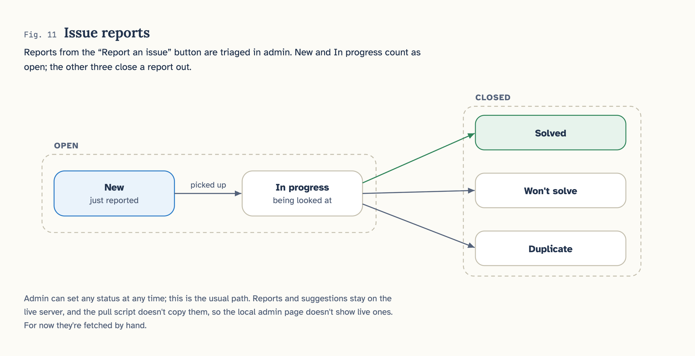

# Stumpty

**A daily brain teaser to help people use and stretch their minds.**

Stumpty serves a single brain teaser every day to help people use and stretch
their minds. I think that in this day and age it's too easy to rely on AI and it
can make our minds lazy and reduces our processing abilities. I believe that solving 
a challenge a day can help retain our mental sharpness. Even if you aren't able to
solve it, it's the process of trying and attempting to put the pieces together.
Challenges will vary from simple word riddles, to tougher math questions or simply 
taking a step back and looking at the bigger picture. Regardless of the user, anyone
can benefit from it or enjoy solving a quick challenge.

Built with **C# / Blazor Server (.NET 10)**.

---

## Features

**For solvers**
- **Challenge of the day** — one teaser per day, rolling over at midnight Pacific Time
- **Smart answer checking** — accepts what a human would call correct:
  - case and punctuation insensitive (`A Keyboard!` = `a keyboard`)
  - numeric equivalence (`9` = `9.0`, `1,000` = `1000`)
  - spelled-out numbers (`eighty` = `80`, `forty-eight mph` = `48 mph`)
  - multiple accepted phrasings per question
- **Solutions unlock the next day** — never while a challenge is live, however many attempts you make
- **Yesterday's solution page**: a spoiler warning, the question in the open and the answer behind a blur veil, so you can still attempt it first
- **Difficulty badges** — Easy / Medium / Hard, colour-coded green / yellow / red
- **Confetti** on a correct answer
- **Post-solve countdown** to the next challenge
- **Community stats** — "342 out of 1,208 total submissions were correct", revealed only after you solve
- **Suggest a teaser** — visitors can submit their own (rate-limited to one per day)
- **Twenty Four** — make 24 from four dealt cards, as many hands as you like. Not every hand can:
  press **Impossible** if you think yours can't. Hands solved in a row make a run, and the longest
  runs go on a scoreboard, today's and of all time, under given names like *Otter 17*, numbered in the order players joined

**For the author (`/admin`)**
- Add, edit, delete, and queue teasers; new ones run first, one a day in date order,
  and the date defaults to the back of the queue so a whole week can be queued in one sitting
- Set difficulty, attach a support image, and apply backend-only tags for sorting
- Review visitor suggestions and promote good ones straight into the add form
- Per-teaser stats: answers sent and success rate

---

## Quickstart

Requires the .NET 10 SDK. If it's installed under `~/.dotnet` and isn't on your
PATH yet:

```bash
export PATH="$HOME/.dotnet:$PATH"
```

Run the app:

```bash
dotnet run --project OneADay
```

Then open the URL it prints (e.g. <http://localhost:5178>).

Run the test suite:

```bash
dotnet test OneADay.Tests
```

GitHub runs the same command on Linux for every pull request into master and every push to
master ([`.github/workflows/tests.yml`](.github/workflows/tests.yml)). A pull request shows a
green ✓ or a red ✗ beside its commits, and the run's log names any failing test. It sees only
what's committed, so no test may depend on `App_Data/`. Details:
[PRD 11, requirement 17](docs/prd/11-deployment.md).

---

## Adding your daily teaser

Open the **☰ menu → Add a teaser (admin)**, or go straight to `/admin`.

| Field | Notes |
|---|---|
| **Date** | Its place in the queue: new teasers run one a day in date order, from the day after they're uploaded, and a gap closes up. Defaults to the day after the last one waiting. |
| **Pin to this date** | Runs it on exactly its date and never before, for a holiday question. Off by default. |
| **Difficulty** | Easy / Medium / Hard — shown to solvers as a colour-coded badge. |
| **Question** | The teaser itself. |
| **Answer** | Separate alternative accepted answers with `;` — e.g. `48; 48 mph; forty-eight`. |
| **Tags** | Comma-separated labels (`logic, math`) for your own sorting. Never shown to visitors. |
| **Support image** | Optional PNG/JPG/GIF/WebP up to 3 MB, for puzzles that need a diagram. |
| **Hint** | Optional. Kept with the teaser, but the site doesn't show it (PRD 03). |
| **Solution** | Shown once solved, or revealable the day after the challenge runs. |

---

## Deploying to Fly.io

Stumpty runs on [Fly.io](https://fly.io) as one always-on machine with a disk for
`App_Data`, behind Cloudflare. [`fly.toml`](fly.toml) holds the settings and
[`Dockerfile`](Dockerfile) the build. Fly builds on its own servers, so Docker isn't needed
locally. Why Fly, and every requirement: [PRD 11](docs/prd/11-deployment.md).

First time:

1. Install Fly's command-line tool and log in:
   ```bash
   brew install flyctl
   fly auth login
   ```
2. Create the app and its disk. The names must match `fly.toml`; if `stumpty` is taken,
   change `app` there.
   ```bash
   fly apps create stumpty
   fly volumes create stumpty_data --size 1 --region ord --snapshot-retention 30
   ```
3. Set the secrets. Make each key with `openssl rand -base64 32`; `CloudflareLock__Secret`
   must match Cloudflare's header rule (PRD 11, requirement 14). `Jev__ApiKey` is an OpenRouter
   key, from your OpenRouter account (PRD 02). Never put these in a file.
   ```bash
   fly secrets set Privacy__IpHashKey=... CloudflareLock__Secret=... Email__AppPassword=... Jev__ApiKey=...
   ```
   To add the Jev key to a site that's already running, without the key landing in your shell
   history or on screen, paste it at the prompt instead. It takes effect at the next deploy:
   ```bash
   read -s "KEY?Paste your OpenRouter key: " && fly secrets set --stage Jev__ApiKey="$KEY" && unset KEY
   ```
4. Deploy as one machine. Without `--ha=false`, Fly adds a spare, and the data files
   assume a single writer.
   ```bash
   fly deploy --ha=false
   ```
5. Upload the question bank. On a new disk the machine waits for it before starting:
   ```bash
   fly ssh sftp put OneADay/App_Data/teasers.json /app/App_Data/teasers.json
   ```
   Then each question's picture, if any, from `OneADay/App_Data/teaser-images/`. On start the
   site logs a warning for any picture it lacks, with the command that uploads it:
   ```bash
   fly ssh sftp put OneADay/App_Data/teaser-images/<name> /app/App_Data/teaser-images/<name>
   ```
6. Connect stumpty.com with
   [Fly's Cloudflare guide](https://fly.io/docs/networking/understanding-cloudflare/):
   run `fly certs add stumpty.com`, add the `_fly-ownership` record that
   `fly certs setup stumpty.com` shows, point the domain at the app with Cloudflare's proxy
   on, and set Cloudflare's SSL/TLS mode to Full (strict).

After that, `fly deploy --ha=false` ships each update. Updating the question bank on the
live site is the next piece to build (PRD 11, requirement 13).

**Backups.** Fly snapshots the disk every day and keeps 30 days. Take one by hand before
anything risky with `fly volumes snapshots create <volume id>`. To restore, follow the
runbook in [PRD 11, requirement 8](docs/prd/11-deployment.md).

**Seeing the live numbers in admin.** Only the live site counts visitors; this machine never
does, so your own testing stays out of the numbers. To bring the live counts down, stop the
site here, then from the repo folder:

```bash
sh deploy/pull-live-data.sh
```

Start the site again and open `/admin` → **Site metrics** ([PRD 16](docs/prd/16-site-metrics.md)).

**If the site gets busy.** The machine holds 300 open tabs at once (`hard_limit` in
`fly.toml`). Visitors past that find the page won't load until someone leaves, while the site
stays up for everyone already on it. When a spike is coming or happening (a streamer, a big
post), make the machine bigger:

1. In `fly.toml`, change `memory` under `[[vm]]` and both limits under
   `[http_service.concurrency]`:

   | `memory`        | `soft_limit` | `hard_limit` |
   |-----------------|--------------|--------------|
   | `"512mb"` (now) | 250          | 300          |
   | `"1024mb"`      | 600          | 750          |
   | `"2048mb"`      | 1300         | 1600         |

   Each open tab uses about 0.6 MB on top of the app's 110 MB, and each row leaves about as
   much memory to spare as 300 does on 512 MB.
2. If pages load but answers are slow to come back, the processor is the limit, not memory:
   also change `size` to `"shared-cpu-2x"`. Memory was measured under load; the processor
   wasn't.
3. Deploy. The machine restarts, so everyone on the site reconnects once:
   ```bash
   fly deploy --ha=false
   ```
4. When it's quiet again, put the numbers back and deploy again. Fly bills by the second, so a
   bigger machine for a day or two costs cents. If you keep the bigger size, commit the
   `fly.toml` change, or the next deploy from another branch puts the old size back.

Don't add a second machine instead: the data files assume one writer. On a very busy day Jev's
1,000 questions may run out too; after that the checker alone grades until midnight Pacific.

---

## How Stumpty works, in diagrams

Eleven diagrams of how the site is put together and how it behaves, drawn from the code on
`master` at commit 5d90447 on November 10, 2026. At that point
[PR #83](https://github.com/Pallof/One_a_day/pull/83) (new questions first) was still open. It
has since merged, so where a figure shows the way things worked before PR #83 and after it, the
"after" side is how `master` works now. Click any picture to see it full size.


<details>
<summary><b>How it's built</b>: every request in order, inside the app, and a question's journey</summary>


</details>

<details>
<summary><b>How things change</b>: which question runs today, the recycling box, grading an answer, a visitor on today's question, the email list, Twenty Four, and issue reports</summary>




</details>

---

## How it's built

```
OneADay/                     the Blazor app
  Components/
    ChallengeView.razor      shared question + submission + stats UI
    DifficultyBadge.razor    colour-coded Easy/Medium/Hard badge
    Pages/                   Home, Yesterday, TwentyFour, About, Contact, Admin
  Models/BrainTeaser.cs      the teaser + all answer-matching rules
  Services/
    TeaserStore.cs           reads/writes teasers.json
    StatsStore.cs            anonymous attempt statistics
    SuggestionStore.cs       visitor suggestions + rate limiting
    ImageStore.cs            support-image uploads
    AppTime.cs               pins "today" to midnight Pacific
  App_Data/                  ← all data lives here (see below)
OneADay.Tests/               xUnit tests for answer validation
```

| Route | Page |
|---|---|
| `/` | Challenge of the day |
| `/yesterday` | Yesterday's solution: the question, with the answer behind a tap |
| `/twentyfour` | Twenty Four — make 24 from four dealt cards, with a scoreboard of the longest runs |
| `/about` · `/contact` | About, and the suggest-a-teaser form |
| `/admin` | Author tools |

### Where the data lives

There is **no database**. Everything is human-readable JSON in `OneADay/App_Data/`,
so the whole site can be backed up by copying a folder or edited by hand:

> **`App_Data/` is deliberately not in version control.** It holds the question
> bank — including every answer and unpublished teaser — plus visitor-submitted
> text, none of which belongs in a public repo. Back the folder up out-of-band;
> it is the app's only datastore. A fresh clone starts with a few sample teasers
> generated on first run.

### Design decisions worth knowing

- **No accounts.** An early login page was removed — accounts accomplished nothing
  here. Statistics are just two numbers per puzzle — answers submitted, and answers
  correct — so they record nothing about who answered.
- **Pacific-pinned clock.** Every page and the post-solve countdown share one
  `America/Los_Angeles` day boundary, so the timer hitting 00:00:00 and the new
  teaser appearing are always the same moment.
- **Answers are never trusted input.** Submissions are compared in memory and never
  stored or interpolated anywhere; Blazor HTML-encodes everything it renders.

---

## Design origins

The app follows the original wireframes, kept in [`Picture Directory/`](Picture%20Directory):

| Site map | Home page |
|---|---|
|  |  |

The original design also included an [all-questions page](Picture%20Directory/Search_Page--All_questions_page.png);
that archive was built and later removed — see [PRD 04](docs/prd/04-archive-and-discovery.md).

There is also a [login page wireframe](Picture%20Directory/login_Page.png) from the
original design, kept for reference — the app deliberately has no accounts today.

> The project began in 2020 as a React sketch; it was rebuilt from these same
> wireframes as a Blazor app.

---

## Status & roadmap

Working today: everything in the feature list above, live at https://stumpty.com.

Before deploying publicly:
- [x] **Protect `/admin`** — it only exists on the author's machine; the live site answers
      `/admin` with a "No entry" page (PRD 10)
- [x] Pick a host: Fly.io, behind Cloudflare (PRD 11)
- [x] Deploy — live at https://stumpty.com; see [Deploying to Fly.io](#deploying-to-flyio)

Ideas after that:
- [ ] Solve streaks and a share button ("Stumpty #12 — solved in 2 attempts")
- [ ] A "queue is running dry" warning when no teaser is scheduled for tomorrow
- [ ] Bulk import so a week of teasers can be added at once

---

## Docs

- [`docs/prd/`](docs/prd) — product requirements: a spec of record for everything
  built, plus proposals for what's next
- [`OneADay/README.md`](OneADay/README.md) — deeper notes on the app, its data
  files, and the answer-validation rules
